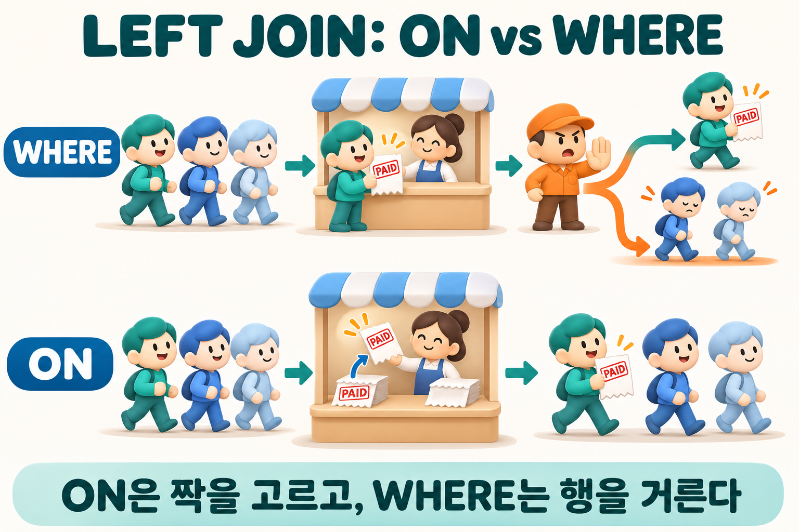

## 질문
모든 고객과 그 고객의 결제 완료 주문 수를 조회하려고 LEFT JOIN 뒤 WHERE o.status = 'PAID'를 붙였더니, 주문이 없는 고객이 결과에서 사라졌습니다. 왜 그런가요?

## 정답
`LEFT JOIN`은 오른쪽 테이블에 맞는 행이 없는 고객도 남기고, 오른쪽 컬럼을 NULL로 채웁니다. 그런데 `WHERE`는 조인이 끝난 결과에 적용되므로, `o.status`가 NULL인 행은 `o.status = 'PAID'` 조건을 통과하지 못하고 제거됩니다. 결과적으로 INNER JOIN과 같아집니다.

주문이 없는 고객도 남기려면 오른쪽 테이블에 대한 조건을 `ON` 절로 옮겨 `LEFT JOIN orders o ON o.customer_id = c.id AND o.status = 'PAID'`처럼 작성합니다.

## 해설
### 예시 데이터

- 고객: 김만듦(1), 이데이터(2), 박자바(3)
- 주문: 김만듦의 PAID 주문 2건, 이데이터의 CANCELED 주문 1건, 박자바는 주문 없음

### WHERE에 조건을 둔 경우

```sql
SELECT c.name, COUNT(o.id) AS paid_orders
FROM customers c
LEFT JOIN orders o ON o.customer_id = c.id
WHERE o.status = 'PAID'
GROUP BY c.name;
```

조인 직후에는 박자바 행이 `o.status = NULL`로 남아 있습니다. 이데이터의 행은 `CANCELED`입니다. 이후 `WHERE`가 두 행을 모두 걸러내므로 결과에는 김만듦만 남습니다.



출구 검사대는 `WHERE`, 창구 안에서 영수증을 고르는 단계는 `ON`에 대응하는 비유입니다. `WHERE`는 짝을 맞춘 뒤 행 전체를 걸러내고, `ON`은 어떤 행과 짝을 맞출지만 정합니다.

### ON에 조건을 둔 경우

```sql
SELECT c.name, COUNT(o.id) AS paid_orders
FROM customers c
LEFT JOIN orders o
  ON o.customer_id = c.id
 AND o.status = 'PAID'
GROUP BY c.name;
```

이제 결제 완료 주문만 짝으로 붙고, 짝이 없는 고객은 NULL과 함께 남습니다.

- 김만듦: 2
- 이데이터: 0
- 박자바: 0

### COUNT(*)가 아니라 COUNT(o.id)

`COUNT(*)`는 행 수를 세므로 짝이 없어 NULL로 채워진 행도 1로 셉니다. `COUNT(o.id)`는 NULL이 아닌 값만 세므로 주문이 없는 고객을 0으로 계산합니다.

### 기억할 점

- `LEFT JOIN`에서 오른쪽 테이블 조건은 `ON`에, 결과 전체를 거르는 조건은 `WHERE`에 둡니다.
- 왼쪽 테이블에 대한 조건(예: 활성 고객만)은 `WHERE`에 두는 것이 의도에 맞습니다.
- `INNER JOIN`에서는 조건을 `ON`과 `WHERE` 중 어디에 두어도 결과가 같습니다.

### 참고 자료

- [PostgreSQL — Joined Tables](https://www.postgresql.org/docs/current/queries-table-expressions.html#QUERIES-JOIN)
