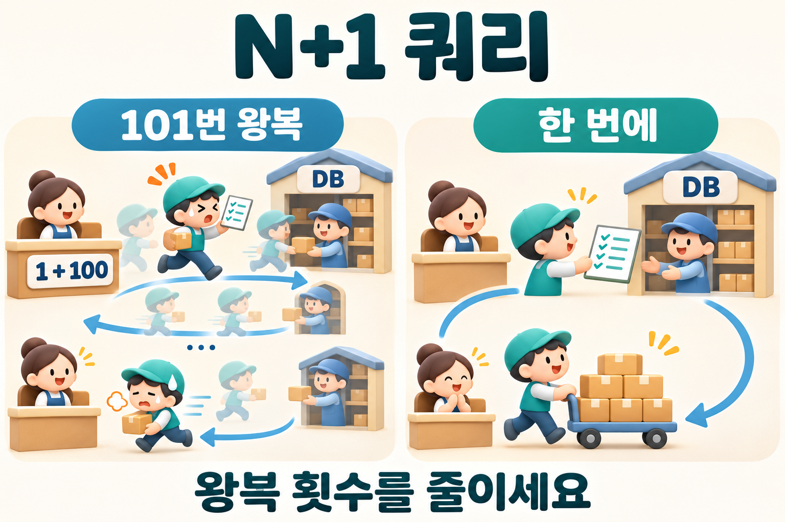

## 질문
게시글 목록 100개를 조회한 뒤, 각 게시글의 작성자 이름을 보여주려고 반복문에서 작성자를 하나씩 조회했습니다. 이때 쿼리는 몇 번 실행되며, 어떻게 줄일 수 있나요?

## 정답
게시글 목록을 가져오는 쿼리 1번에, 게시글마다 작성자를 조회하는 쿼리 100번이 더해져 총 101번이 실행됩니다. 이를 N+1 문제라고 합니다. 쿼리 하나는 빠르더라도 DB와 주고받는 횟수가 많아져 전체 응답이 느려집니다.

JOIN으로 게시글과 작성자를 한 번에 가져오거나, 필요한 작성자 ID를 모아 `IN` 조건으로 한 번에 조회하면 쿼리 수를 1~2번으로 줄일 수 있습니다.

## 해설
### 어떻게 101번이 될까요?

```sql
-- 1번: 게시글 목록
SELECT id, title, author_id FROM posts ORDER BY id DESC LIMIT 100;

-- 게시글마다 반복 (100번)
SELECT name FROM users WHERE id = ?;
```

코드에서는 반복문 한 줄처럼 보이지만, DB 입장에서는 100번의 요청이 따로 들어옵니다. 요청마다 네트워크 왕복과 처리 비용이 더해집니다.



창고는 데이터베이스, 한 번의 왕복은 쿼리 한 번에 대응하는 비유입니다. 물건 하나를 가져오는 시간은 짧아도, 왕복 횟수가 많으면 전체 시간이 길어집니다.

### 해결 1: JOIN으로 한 번에

```sql
SELECT p.id, p.title, u.name AS author_name
FROM posts p
JOIN users u ON u.id = p.author_id
ORDER BY p.id DESC
LIMIT 100;
```

한 번의 쿼리로 게시글과 작성자 이름을 함께 가져옵니다.

### 해결 2: IN으로 모아서 조회

```sql
SELECT id, name FROM users WHERE id IN (3, 7, 12, ...);
```

먼저 게시글 목록에서 작성자 ID를 모은 뒤, 작성자를 한 번에 조회하고 애플리케이션에서 짝을 맞춥니다. 총 2번의 쿼리로 끝납니다.

### ORM을 쓸 때 더 잘 숨어 있어요

JPA 같은 ORM에서 연관 객체를 지연 로딩(lazy loading)으로 설정하면, `post.getAuthor().getName()`을 호출하는 순간 쿼리가 실행됩니다. 코드에는 SQL이 보이지 않아서 N+1이 생긴 줄 모르기 쉽습니다.

JPA에서는 fetch join이나 `@EntityGraph`로 한 번에 가져오거나, 배치 크기 설정으로 여러 건을 `IN`으로 묶어 조회할 수 있습니다. 다만 일대다 컬렉션을 fetch join하면서 페이지 처리를 함께 하면 결과가 의도와 다를 수 있으니 주의해야 합니다.

### 기억할 점

- 개발 중에는 실행된 SQL 로그를 켜 두고, 목록 화면 하나에 쿼리가 몇 번 나가는지 확인합니다.
- 데이터가 적을 때는 차이가 작아 보여도, 목록 크기에 비례해 쿼리가 늘어나는 구조라면 미리 고치는 것이 좋습니다.

### 참고 자료

- [Hibernate ORM User Guide — Fetching](https://docs.jboss.org/hibernate/orm/current/userguide/html_single/Hibernate_User_Guide.html#fetching)
