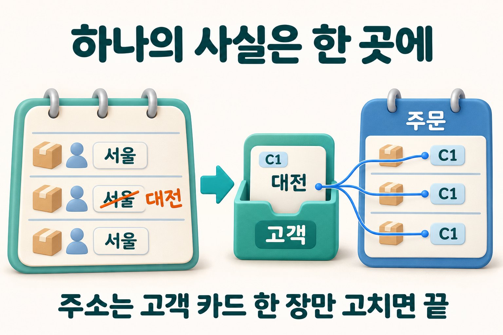

## 질문
주문 테이블 한 곳에 고객 이름과 주소를 매번 함께 저장하면 어떤 문제가 생기나요? 정규화는 이 문제를 어떻게 해결하나요?

## 정답
같은 고객 정보가 주문마다 반복 저장되므로, 주소가 바뀌면 여러 행을 모두 고쳐야 하고 일부만 고치면 데이터가 서로 달라집니다. 주문이 없는 고객은 저장하기 어렵고, 마지막 주문을 지우면 고객 정보까지 사라질 수 있습니다. 이런 문제를 갱신·삽입·삭제 이상이라고 합니다.

정규화는 하나의 사실을 한 곳에만 저장하도록 테이블을 나누는 과정입니다. 고객 정보는 고객 테이블에, 주문 정보는 주문 테이블에 두고 고객 ID로 연결하면 주소는 한 곳만 고치면 됩니다.

## 해설
### 한 테이블에 모두 담았을 때

- 주문 1: 고객 C1 · 김만듦 · 서울 · 키보드
- 주문 2: 고객 C1 · 김만듦 · 서울 · 마우스
- 주문 3: 고객 C2 · 이데이터 · 부산 · 모니터

김만듦 고객의 주소가 서울에서 대전으로 바뀌면 1번과 2번 주문 행을 모두 고쳐야 합니다. 한 행만 고치면 같은 고객의 주소가 두 개가 됩니다.

### 세 가지 이상 현상

- **갱신 이상**: 같은 정보가 여러 행에 있어 일부만 수정되면 데이터가 서로 맞지 않습니다.
- **삽입 이상**: 아직 주문하지 않은 고객을 저장하려면 주문 정보 없이 빈 칸을 남겨야 합니다.
- **삭제 이상**: 이데이터 고객의 유일한 주문인 3번을 지우면 고객 정보도 함께 사라집니다.

### 하나의 사실은 한 곳에



고객 카드함은 고객 테이블, 주문 장부는 주문 테이블에 대응하는 비유입니다. 주문 장부에는 고객 번호만 적혀 있으므로, 주소가 바뀌면 고객 카드 한 장만 고치면 됩니다.

```sql
CREATE TABLE customers (
  id      VARCHAR(10) PRIMARY KEY,
  name    VARCHAR(50) NOT NULL,
  address VARCHAR(200) NOT NULL
);

CREATE TABLE orders (
  id          BIGINT PRIMARY KEY,
  customer_id VARCHAR(10) NOT NULL REFERENCES customers(id),
  product     VARCHAR(100) NOT NULL
);
```

### 정규형 단계 간단히 보기

- **1정규형**: 한 칸에는 하나의 값만 넣습니다. "키보드, 마우스"처럼 여러 값을 한 칸에 넣지 않습니다.
- **2정규형**: 여러 컬럼을 합친 기본 키가 있을 때, 키의 일부에만 의존하는 컬럼을 분리합니다.
- **3정규형**: 키가 아닌 컬럼에 의존하는 컬럼을 분리합니다. 위 예시에서 고객주소는 주문번호가 아니라 고객ID에 따라 정해지므로 고객 테이블로 옮깁니다.

### 항상 끝까지 나누는 것이 정답은 아니에요

테이블을 나누면 조회할 때 JOIN이 필요합니다. 읽기 성능이 매우 중요하면 일부러 데이터를 중복 저장하는 반정규화를 선택하기도 합니다. 이때는 중복된 값을 함께 맞추는 방법을 따로 마련해야 합니다.

주문 당시의 배송지처럼 "그때의 값"을 기록해야 하는 경우도 있습니다. 이것은 고객의 현재 주소와 다른 사실이므로 주문 테이블에 저장하는 것이 맞습니다.

### 참고 자료

- [PostgreSQL — Constraints (Foreign Keys)](https://www.postgresql.org/docs/current/ddl-constraints.html)
