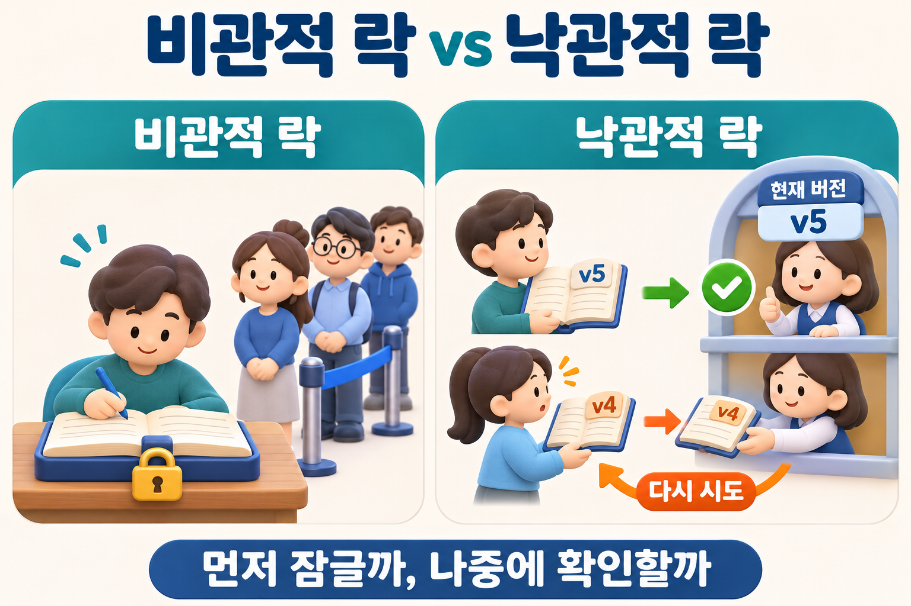

## 질문
두 사용자가 같은 상품의 재고를 동시에 수정하려고 합니다. 비관적 락과 낙관적 락은 이 충돌을 각각 어떻게 막으며, 어떤 상황에 어울리나요?

## 정답
비관적 락은 충돌이 일어날 것이라고 보고, 데이터를 읽을 때 먼저 잠급니다. `SELECT ... FOR UPDATE`로 행을 잠그면 다른 트랜잭션은 잠금이 풀릴 때까지 기다립니다.

낙관적 락은 충돌이 드물다고 보고 잠그지 않습니다. 대신 버전 번호를 함께 저장해 두고, 수정할 때 읽었던 버전이 그대로인지 확인합니다. 그사이 다른 사람이 먼저 수정했다면 수정이 실패하므로 다시 시도합니다.

충돌이 잦고 실패 비용이 크면 비관적 락이, 충돌이 드물고 읽기가 많으면 낙관적 락이 어울립니다.

## 해설
### 아무것도 하지 않으면

재고가 10개일 때 A와 B가 동시에 10을 읽고, 각자 1개씩 판매해 9를 저장하면 결과는 8이 아니라 9입니다. 한 사람의 변경이 사라지는 갱신 손실이 생깁니다.



자물쇠는 비관적 락, 페이지 번호 확인은 낙관적 락의 버전 확인에 대응하는 비유입니다. 비관적 락은 먼저 막고, 낙관적 락은 나중에 확인합니다.

### 비관적 락: 먼저 잠그기

```sql
BEGIN;
SELECT stock FROM products WHERE id = 1 FOR UPDATE;
-- 다른 트랜잭션의 FOR UPDATE는 여기서 대기
UPDATE products SET stock = stock - 1 WHERE id = 1;
COMMIT;
```

한 번에 한 트랜잭션만 행을 수정하므로 갱신 손실이 생기지 않습니다. 대신 기다리는 시간이 생기고, 여러 행을 서로 다른 순서로 잠그면 교착 상태가 생길 수 있습니다.

### 낙관적 락: 나중에 확인하기

```sql
-- 읽을 때 버전도 함께 조회 (stock = 10, version = 5)
SELECT stock, version FROM products WHERE id = 1;

-- 수정할 때 버전이 그대로인지 확인
UPDATE products
SET stock = 9, version = version + 1
WHERE id = 1 AND version = 5;
```

먼저 수정한 사람 때문에 버전이 6이 되었다면, 늦은 사람의 `UPDATE`는 조건에 맞는 행이 없어 0건이 수정됩니다. 애플리케이션은 0건을 보고 충돌을 알아차린 뒤 다시 읽어서 시도하거나 사용자에게 알립니다.

JPA에서는 엔티티에 `@Version` 필드를 두면 이 확인을 자동으로 해 줍니다.

### 어떤 것을 고를까요?

- **비관적 락**: 인기 상품 재고처럼 같은 행에 동시 수정이 자주 몰리고, 재시도 비용이 큰 경우
- **낙관적 락**: 게시글 수정처럼 같은 데이터를 동시에 고치는 일이 드물고, 잠금 대기를 피하고 싶은 경우

재고 차감처럼 단순한 계산이라면 `UPDATE products SET stock = stock - 1 WHERE id = 1 AND stock > 0`처럼 한 문장으로 처리하는 방법도 있습니다. DB가 행 단위로 처리하므로 별도의 읽기 단계가 필요 없습니다.

### 참고 자료

- [PostgreSQL — Explicit Locking](https://www.postgresql.org/docs/current/explicit-locking.html)
- [Jakarta Persistence — Version](https://jakarta.ee/specifications/persistence/3.1/apidocs/jakarta.persistence/jakarta/persistence/version)
