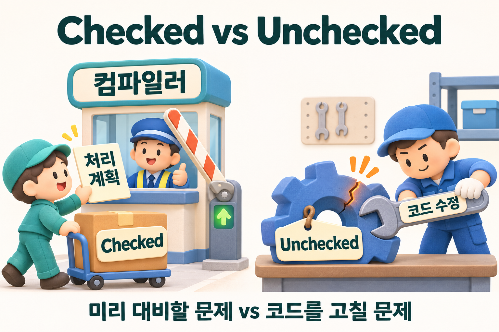

## 질문
Java에서 checked 예외와 unchecked 예외는 어떻게 구분되나요? 각각 어떤 상황에 사용하는 것이 적절한가요?

## 정답
`Exception`을 상속하지만 `RuntimeException`의 하위가 아닌 예외는 checked 예외입니다. 컴파일러가 처리 여부를 검사하므로 `try-catch`로 잡거나 `throws`로 선언해야 합니다. `RuntimeException`과 그 하위 예외, 그리고 `Error`는 unchecked이며 처리하지 않아도 컴파일됩니다.

호출한 쪽이 대응할 수 있는 외부 상황(파일이 없음, 네트워크 실패 등)에는 checked 예외가, 잘못된 인자나 null 참조처럼 코드를 고쳐야 하는 프로그래밍 오류에는 unchecked 예외가 어울립니다.

## 해설
### 예외 계층 구조

```text
Throwable
├── Error                 (unchecked: 시스템 수준 문제)
└── Exception             (checked)
    ├── IOException       (checked)
    └── RuntimeException  (unchecked)
        ├── NullPointerException
        └── IllegalArgumentException
```

`Error`는 `OutOfMemoryError`처럼 애플리케이션이 복구하기 어려운 문제를 나타내므로, 보통 직접 잡지 않습니다.



검문소는 컴파일러, Checked 상자는 checked 예외, 작업장의 깨진 톱니바퀴는 unchecked 예외에 대응하는 비유입니다. checked 예외는 컴파일 단계에서 처리 계획을 요구받습니다.

### checked 예외: 컴파일러가 확인해요

```java
String read(Path path) throws IOException {
    return Files.readString(path);
}
```

`Files.readString`은 `IOException`을 던질 수 있습니다. 이 메서드를 호출하는 쪽도 예외를 잡거나 다시 선언해야 컴파일됩니다. 호출한 쪽에게 "파일이 없을 수 있으니 대비하라"고 알려주는 셈입니다.

### unchecked 예외: 코드를 고쳐야 하는 문제

```java
void setAge(int age) {
    if (age < 0) {
        throw new IllegalArgumentException("나이는 0 이상이어야 합니다: " + age);
    }
    this.age = age;
}
```

음수 나이를 넘기는 것은 호출한 코드의 실수입니다. 모든 호출부에 `try-catch`를 강제하기보다, 잘못된 사용을 바로 드러내는 것이 낫습니다.

### 예외를 다룰 때 주의할 점

- 예외를 잡고 아무것도 하지 않으면 문제가 조용히 사라집니다. 최소한 기록하거나, 처리할 수 없다면 다시 던집니다.
- 다른 예외로 바꿔 던질 때는 원래 예외를 원인으로 넘겨야 추적할 수 있습니다.

```java
try {
    return Files.readString(path);
} catch (IOException e) {
    throw new UncheckedIOException("설정 파일을 읽지 못했습니다: " + path, e);
}
```

- Spring의 `@Transactional`은 기본 설정에서 unchecked 예외(`RuntimeException`, `Error`)가 발생할 때만 롤백합니다. checked 예외에도 롤백이 필요하면 `rollbackFor`로 지정해야 합니다.

### 참고 자료

- [Oracle Java Tutorials — Unchecked Exceptions: The Controversy](https://docs.oracle.com/javase/tutorial/essential/exceptions/runtime.html)
