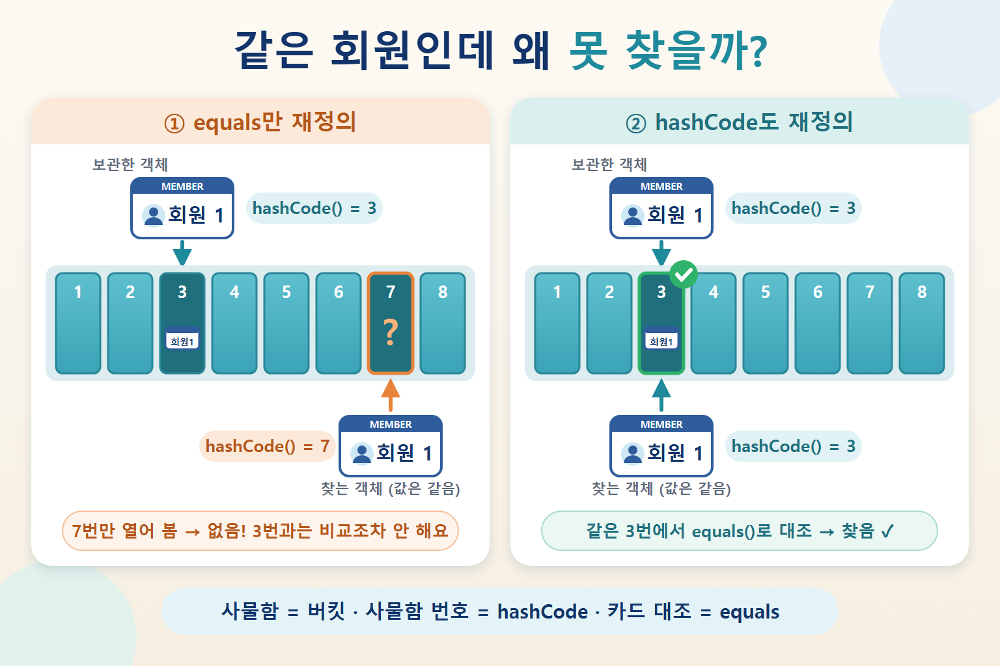

## 질문
자바에서 `==`와 `equals()`는 무엇이 다르고, `equals()`를 재정의할 때 `hashCode()`도 함께 재정의해야 하는 이유는 무엇인가요?

## 정답
`==`는 기본형이면 값을, 참조형이면 두 변수가 같은 객체를 가리키는지를 비교합니다. `equals()`는 객체가 논리적으로 같은지를 비교하도록 재정의할 수 있습니다. `HashMap`·`HashSet`은 `hashCode()`로 버킷을 먼저 찾은 뒤 `equals()`로 비교하므로, `equals()`가 같다고 판단한 두 객체는 반드시 같은 `hashCode()`를 반환해야 합니다.

## 해설
### 같은 객체인가, 같은 값인가

회원증 두 장을 생각해 보세요. `==`는 두 사람이 **같은 카드 한 장**을 들고 있는지 확인하고, `equals()`는 두 카드에 적힌 **회원 번호가 같은지** 확인합니다. `Object`의 기본 `equals()`는 `==`와 똑같이 동작하므로, 값으로 비교하고 싶다면 직접 재정의해야 합니다.

```java
String a = new String("java");
String b = new String("java");
System.out.println(a == b);      // false: 서로 다른 객체
System.out.println(a.equals(b)); // true: 같은 문자열 값
```

### hashCode가 어긋나면 생기는 일

`HashSet`은 객체를 넣거나 찾을 때 `hashCode()`로 버킷을 먼저 고르고, 그 버킷 안에서만 `equals()`로 비교합니다. 그래서 `equals()`만 재정의하고 `hashCode()`를 그대로 두면, 같은 회원 번호의 두 객체가 서로 다른 버킷으로 가서 비교조차 되지 않을 수 있습니다.



사물함은 버킷, 사물함 번호는 hashCode, 카드 대조는 equals에 대응하는 비유입니다. HashSet은 고른 사물함 안에서만 비교하므로, 사물함 번호가 다르면 값이 같은 회원도 찾지 못합니다.

```java
record Member(long id) {} // record는 equals와 hashCode를 함께 생성합니다

Set<Member> members = new HashSet<>();
members.add(new Member(1));
System.out.println(members.contains(new Member(1))); // true
```

일반 클래스에서 `equals()`만 재정의했다면 위의 `contains`는 `false`가 되고, 중복 제거도 기대처럼 동작하지 않을 수 있습니다. 직접 구현할 때는 `equals()`에서 비교한 필드로 `Objects.hash(id)`처럼 해시값을 만들면 됩니다.

### 기억할 점

- `equals()`가 같으면 `hashCode()`도 반드시 같아야 합니다.
- 반대로 `hashCode()`가 같다고 `equals()`가 같은 것은 아닙니다. 서로 다른 객체도 해시값이 충돌할 수 있습니다.
- 해시 컬렉션에 넣은 뒤 비교에 쓰는 필드를 바꾸면 그 객체를 다시 찾지 못할 수 있으니, 키로 쓰는 객체는 불변으로 만드는 것이 안전합니다.

### 참고 자료

- [Oracle Java — Object (equals, hashCode)](https://docs.oracle.com/en/java/javase/21/docs/api/java.base/java/lang/Object.html)
