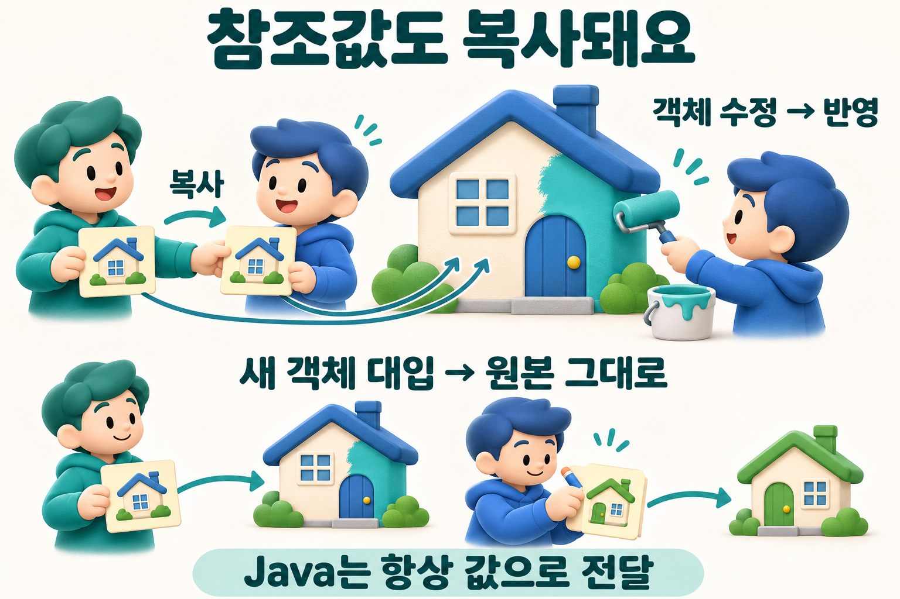

## 질문
Java는 메서드에 인자를 넘길 때 값에 의한 전달(call by value)인가요, 참조에 의한 전달(call by reference)인가요? 메서드 안에서 객체의 필드를 바꾸면 호출한 쪽에도 반영되는 이유는 무엇인가요?

## 정답
Java는 항상 값에 의한 전달입니다. 기본형은 값 자체가 복사되고, 객체 타입은 객체를 가리키는 참조값이 복사되어 전달됩니다.

복사된 참조값도 같은 객체를 가리키므로, 메서드 안에서 그 객체의 필드를 바꾸면 호출한 쪽에서도 바뀐 내용이 보입니다. 하지만 매개변수에 새 객체를 대입하면 복사본만 다른 객체를 가리키게 될 뿐, 호출한 쪽의 변수는 그대로입니다.

## 해설
### 기본형: 값이 복사돼요

```java
void addOne(int n) {
    n = n + 1;
}

int x = 10;
addOne(x);
System.out.println(x); // 10
```

`n`은 `x`의 값을 복사한 별개의 변수입니다. `n`을 바꿔도 `x`에는 영향이 없습니다.

### 객체: 참조값이 복사돼요

```java
void rename(User user) {
    user.setName("이자바"); // 같은 객체의 필드를 수정
}

User u = new User("김만듦");
rename(u);
System.out.println(u.getName()); // 이자바
```

`user`와 `u`는 서로 다른 변수지만, 같은 객체의 위치를 담고 있습니다. 그래서 `user`를 통해 객체를 고치면 `u`로 봐도 바뀐 내용이 보입니다.



주소 쪽지는 참조값, 집은 힙의 객체에 대응하는 비유입니다. 복사한 쪽지로 같은 집을 찾아가 고칠 수는 있지만, 쪽지를 고쳐 써도 원래 쪽지는 바뀌지 않습니다.

### 새 객체를 대입하면 달라요

```java
void replace(User user) {
    user = new User("박디비"); // 복사본만 새 객체를 가리킴
}

User u = new User("김만듦");
replace(u);
System.out.println(u.getName()); // 김만듦
```

참조에 의한 전달이라면 `u` 자체가 새 객체를 가리키게 되어 "박디비"가 출력되어야 합니다. 하지만 Java에서는 매개변수 `user`라는 복사본만 바뀝니다.

### swap이 동작하지 않는 이유

```java
void swap(User a, User b) {
    User temp = a;
    a = b;
    b = temp;
}
```

이 메서드는 매개변수 복사본끼리만 바꿉니다. 호출한 쪽의 두 변수는 원래 객체를 그대로 가리킵니다. 두 값을 바꾼 결과가 필요하다면 배열이나 객체에 담아 그 내용을 바꾸거나, 결과를 반환하도록 설계합니다.

### 기억할 점

- "객체가 전달된다"가 아니라 "객체를 가리키는 참조값이 복사되어 전달된다"고 이해하면 헷갈리지 않습니다.
- 메서드가 인자로 받은 객체를 수정하면 호출한 쪽에도 영향을 줍니다. 의도하지 않은 변경을 막으려면 불변 객체를 사용하거나 복사본을 만들어 다룹니다.

### 참고 자료

- [Oracle Java Tutorials — Passing Information to a Method or a Constructor](https://docs.oracle.com/javase/tutorial/java/javaOO/arguments.html)
