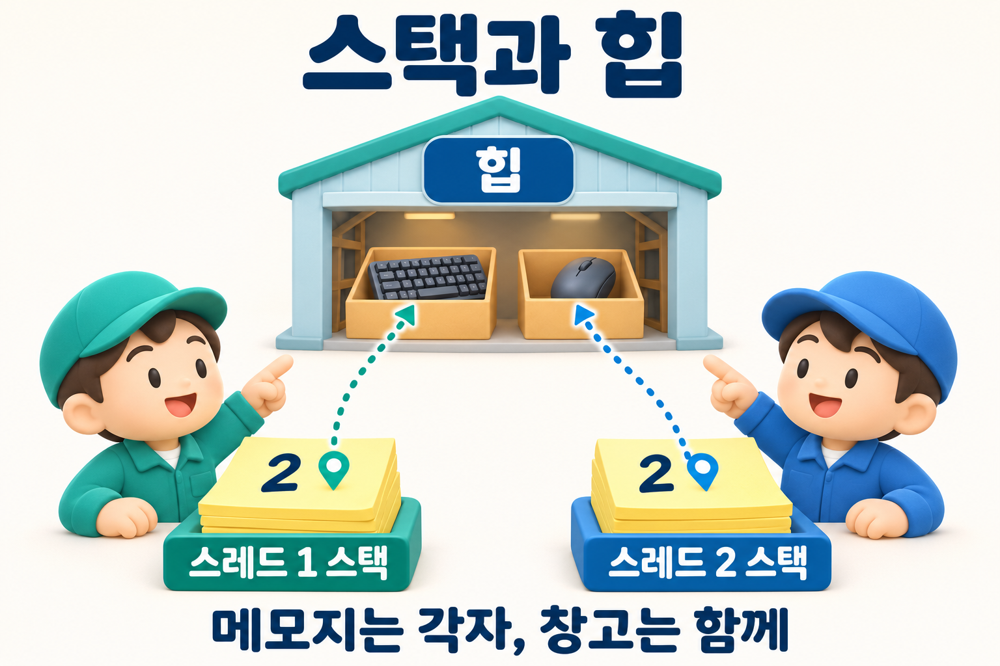

## 질문
Java에서 메서드 안의 지역 변수와 new로 만든 객체는 각각 JVM 메모리의 어디에 저장되나요? 스택과 힙은 어떤 차이가 있나요?

## 정답
메서드를 호출하면 그 스레드의 스택에 프레임이 하나 쌓이고, 지역 변수와 매개변수는 이 프레임에 저장됩니다. `int` 같은 기본형은 값 자체가, 객체 타입 변수는 객체를 가리키는 참조값이 저장됩니다. `new`로 만든 객체는 힙에 저장됩니다.

스택은 스레드마다 따로 있고 메서드가 끝나면 프레임이 바로 사라집니다. 힙은 모든 스레드가 함께 사용하며, 더 이상 참조되지 않는 객체를 GC가 정리합니다.

## 해설
### 코드로 따라가 보기

```java
void order() {
    int count = 2;
    Item item = new Item("키보드");
    print(item);
}
```

- `order()`가 호출되면 스택에 `order` 프레임이 생깁니다.
- `count`에는 값 `2`가 프레임 안에 바로 저장됩니다.
- `new Item("키보드")`로 만든 객체는 힙에 생기고, `item` 변수에는 그 객체의 참조값이 저장됩니다.
- `print(item)`을 호출하면 그 위에 `print` 프레임이 쌓이고, 참조값이 복사되어 전달됩니다.



작업자별 메모지 더미는 스레드의 스택, 공용 창고는 힙, 위치표는 참조값에 대응하는 비유입니다. 메모지는 작업이 끝나면 바로 버려지지만, 창고의 물건은 위치표가 모두 사라진 뒤 GC가 정리합니다.

### 스택의 특징

- 스레드마다 하나씩 있어서 다른 스레드가 내 지역 변수에 접근할 수 없습니다.
- 메서드가 끝나면 프레임이 통째로 사라지므로, 관리가 단순하고 빠릅니다.
- 크기가 비교적 작습니다. 종료 조건 없는 재귀처럼 프레임이 끝없이 쌓이면 `StackOverflowError`가 발생합니다.

### 힙의 특징

- 모든 스레드가 함께 사용합니다. 여러 스레드가 같은 객체를 수정하면 동기화가 필요합니다.
- 메서드가 끝나도 객체는 남아 있을 수 있습니다. 다른 곳에서 참조하고 있다면 계속 살아 있습니다.
- 공간이 부족하고 GC로도 확보하지 못하면 `OutOfMemoryError`가 발생합니다.

### 메서드가 끝나도 객체가 남는 경우

```java
Item create() {
    Item item = new Item("마우스");
    return item; // 참조값을 호출한 쪽에 돌려줌
}
```

`create()`가 끝나면 `item` 변수는 사라지지만, 호출한 쪽이 참조값을 받았으므로 힙의 객체는 계속 사용할 수 있습니다.

### 기억할 점

- 이 설명은 JVM 명세가 정의하는 개념적인 구조입니다. 실제 JVM은 최적화를 위해 메서드 밖으로 나가지 않는 객체를 힙에 만들지 않기도 하지만, 프로그램의 동작은 같습니다.
- 지역 변수는 스레드 사이에 공유되지 않지만, 지역 변수가 가리키는 힙의 객체는 공유될 수 있습니다.

### 참고 자료

- [Oracle — The Java Virtual Machine Specification: Run-Time Data Areas](https://docs.oracle.com/javase/specs/jvms/se21/html/jvms-2.html#jvms-2.5)
