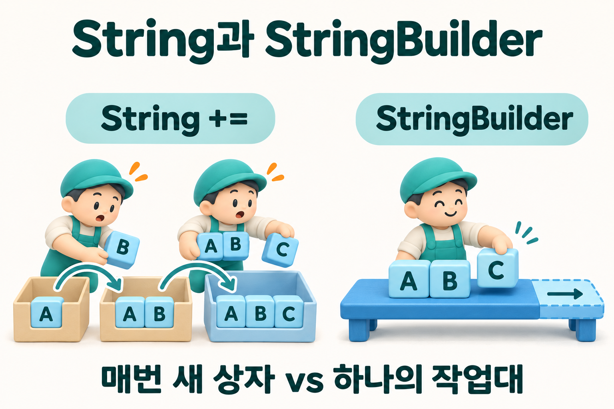

## 질문
Java의 String은 왜 불변(immutable) 객체로 설계되었나요? 반복문에서 문자열을 +로 계속 이어 붙이면 어떤 문제가 생기고, 어떻게 개선할 수 있나요?

## 정답
String 객체는 한 번 만들어지면 내용이 바뀌지 않습니다. 그래서 여러 곳에서 같은 문자열을 안전하게 공유할 수 있고, 해시값을 저장해 두고 다시 쓸 수 있으며, 여러 스레드가 동시에 읽어도 안전합니다.

대신 문자열을 "수정"하면 실제로는 새 String 객체가 만들어집니다. 반복문에서 `+=`로 계속 이어 붙이면 매번 새 객체를 만들고 이전 내용을 복사하므로, 반복 횟수가 많을수록 시간과 메모리가 낭비됩니다. 이럴 때는 내부 버퍼를 직접 늘려 가며 이어 붙이는 `StringBuilder`를 사용합니다.

## 해설
### 바뀌는 것은 문자열이 아니라 변수가 가리키는 대상이에요

```java
String s = "hello";
s = s + " world";
```

이 코드는 `"hello"` 객체를 고치는 것이 아닙니다. `"hello world"`라는 새 객체를 만들고, 변수 `s`가 그 새 객체를 가리키도록 바꿉니다. 원래의 `"hello"` 객체는 그대로 남아 있습니다.

### 불변이라서 얻는 장점

- **안전한 공유**: 같은 문자열 리터럴은 문자열 풀에서 하나의 객체를 함께 사용할 수 있습니다. 누군가 내용을 바꿀 수 없으니 공유해도 문제가 없습니다.
- **해시값 재사용**: `HashMap`의 키로 자주 쓰이는 String은 해시값을 한 번 계산해 두고 다시 사용할 수 있습니다. 내용이 바뀌지 않으니 저장한 값도 계속 맞습니다.
- **스레드 안전**: 여러 스레드가 동시에 읽어도 값이 중간에 바뀌지 않습니다.
- **보안**: 파일 경로나 접속 주소를 검사한 뒤에 다른 코드가 그 문자열을 몰래 바꿀 수 없습니다.

### 반복문에서 `+=`를 쓰면 생기는 일



왼쪽 상자는 String, 오른쪽 작업대는 StringBuilder의 내부 버퍼에 대응하는 비유입니다. 매번 새 상자로 옮겨 담으면, 담긴 블록이 많아질수록 옮기는 일이 점점 커집니다.

```java
String result = "";
for (int i = 0; i < 10000; i++) {
    result += i; // 매번 새 String 객체 생성
}
```

반복할 때마다 지금까지의 내용 전체를 새 객체로 복사합니다. 문자열이 길어질수록 복사할 양도 늘어나므로, 반복 횟수가 커지면 전체 작업량이 빠르게 증가합니다.

### StringBuilder로 개선하기

```java
StringBuilder sb = new StringBuilder();
for (int i = 0; i < 10000; i++) {
    sb.append(i);
}
String result = sb.toString();
```

`StringBuilder`는 내부 버퍼에 내용을 직접 덧붙이고, 공간이 부족할 때만 버퍼를 늘립니다. 마지막에 `toString()`으로 한 번만 String을 만듭니다.

참고로 `"a" + b + "c"`처럼 한 줄에서 끝나는 연결은 컴파일러와 JVM이 알아서 최적화하므로 굳이 바꿀 필요가 없습니다. 문제가 되는 것은 반복문 안에서 결과를 계속 누적하는 경우입니다.

### 기억할 점

- `StringBuilder`는 여러 스레드가 함께 쓰기에 안전하지 않습니다. 동기화가 필요하면 `StringBuffer`가 있지만, 대부분은 메서드 안에서 지역 변수로 `StringBuilder`를 쓰는 것으로 충분합니다.
- 문자열 내용을 비교할 때는 `==`가 아니라 `equals()`를 사용해야 합니다.

### 참고 자료

- [Oracle Java — String](https://docs.oracle.com/en/java/javase/21/docs/api/java.base/java/lang/String.html)
- [Oracle Java — StringBuilder](https://docs.oracle.com/en/java/javase/21/docs/api/java.base/java/lang/StringBuilder.html)
